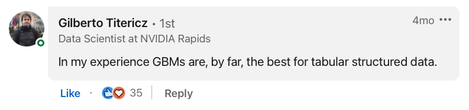
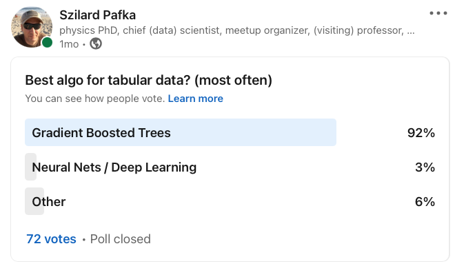

<!-- _class: lead -->

# Benchmarking AI Agents for Optimizing ML Pipelines: An XGBoost Case Study

**Szilard Pafka, PhD**
Chief Scientist, Epoch

Real Data Science Meetup USA (Online) 
December 2026

---

---

### Disclaimer:

I am not representing my employer (Epoch) in this talk

I cannot confirm nor deny if Epoch is using any of the methods, tools, results etc. mentioned in this talk

 

This is partly joint work with Eduardo Ariño de la Rubia

---

# Before AI

## Machine Learning in Business 

* machine learning solving business problems since at least the 90s
* tabular data 
* learn $y=f(x)$ from the data (e.g. binary classification)
* algos: linear, trees, neural networks, SVM etc.
* prediction 
* applications: fraud detection, insurance pricing, credit scoring etc.
* names: analytics, data mining, machine learning, data science

---

## Gradient Boosting / GBM / GBDT

* 1990s: Adaboost (Freund & Schapire), Gradient Boosting Machines (Friedman)
* 2000s: implementations: TreeNet, R gbm
* still somewhat niche, but **2006** Caruana paper (An Empirical Comparison of Supervised Learning Algorithms) put it as **the best algo (beating trees, neural nets, SVM etc.)**
* 2010s: more OS implementations: sklearn, H2O, XGBoost, LightGBM, catboost etc.
* early/mid 2010s: top practitioners know it's usually the best algo
* mid 2010s: implementations improve in scalability (speed/RAM usage)
* later due to success in Kaggle competitions becames common knowledge (esp. after XGboost release) "GBMs are the best ML algo for tabular data"

---

---

