<!-- _class: lead -->

# Benchmarking AI Agents for Optimizing ML Pipelines: An XGBoost Case Study

**Szilard Pafka, PhD**
Chief Scientist, Epoch

Real Data Science Meetup USA (Online) 
December 2026

---

---

### Disclaimer:

- I am not representing my employer (Epoch) in this talk

- I cannot confirm nor deny if Epoch is using any of the methods, tools, results etc. mentioned in this talk

 

* This is partly joint work with Eduardo Ariño de la Rubia

---

# Before AI/LLMs

## Machine Learning in Business 

* machine learning solving business problems since at least the 90s
* tabular data 
* learn $y=f(x)$ from the data (e.g. binary classification)
* algos: linear, trees, neural networks, SVM etc.
* prediction 
* applications: fraud detection, insurance pricing, credit scoring etc.
* names: analytics, data mining, machine learning, data science

---

## Gradient Boosting / GBM / GBDT

* 1990s: Adaboost (Freund & Schapire), Gradient Boosting Machines (Friedman)
* early 2000s: implementations: TreeNet, R gbm
* still somewhat niche, but 2006 Caruana paper (An Empirical Comparison of Supervised Learning Algorithms) put it as the best algo (beating trees, neural nets, SVM etc.)
* 2010s: more OS implementations: sklearn, H2O, XGBoost, LightGBM, catboost etc.
* early/mid 2010s: top practitioners know it's usually the best algo
* mid 2010s: implementations improve in scalability (speed/RAM usage)
* later due to success in Kaggle competitions it became common knowledge (esp. due to XGboost) "*GBMs are the best ML algo for tabular data*"

---

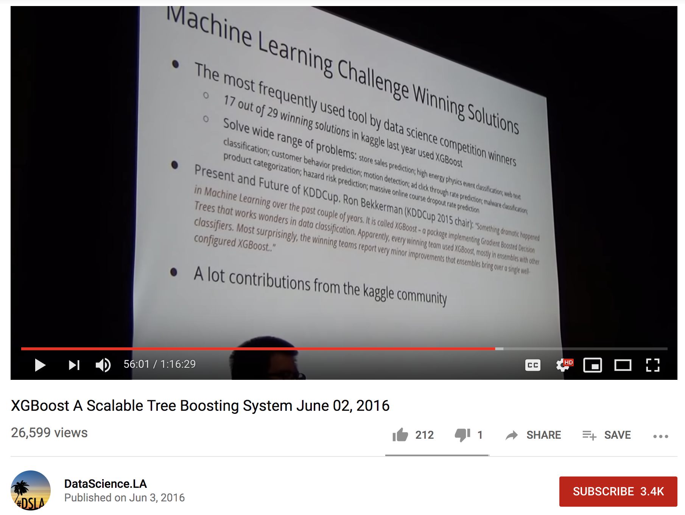

---

- 

* 

---

## GBM implementations

* 2015: ML algos/OS implementations on data sizes 100K, 1M, 10M
    * benchmark accuracy / speed / memory   
    * `https://github.com/szilard/benchm-ml` (~2000 github stars)
    * GBMs + others (random forests, neural nets etc.)
* 2017-present: GBMs only (top: H2O, XGboost, LightGBM, catboost)
    * `https://github.com/szilard/gbm-perf`
    * full automation with Docker
    * GPU implementations
    * tracks performance over the years
    * best in speed: GPU: XGBoost, CPU: LightGBM/XGBoost
    * other criteria: accuracy, ease of deployment

---

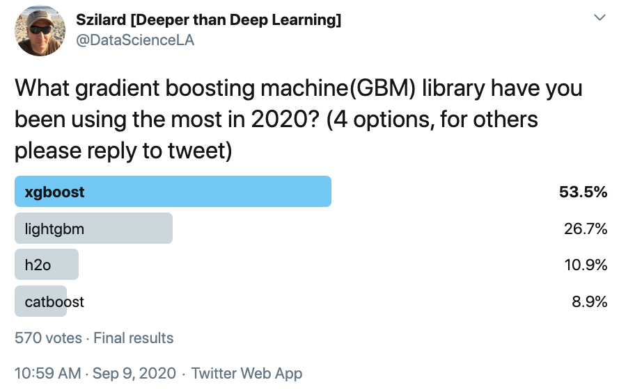

---

## Deep Learning (before LLMs)

* 2010s: computer vision, later other limited domains (e.g. games)
* on tabular/business data usually GBM > (deep) neural nets
* late 2010s/early 2020s: a proliferation of DL methods trying to beat GBMs: TabNet, TabTransformer, SAINT, FT-Transformer
* 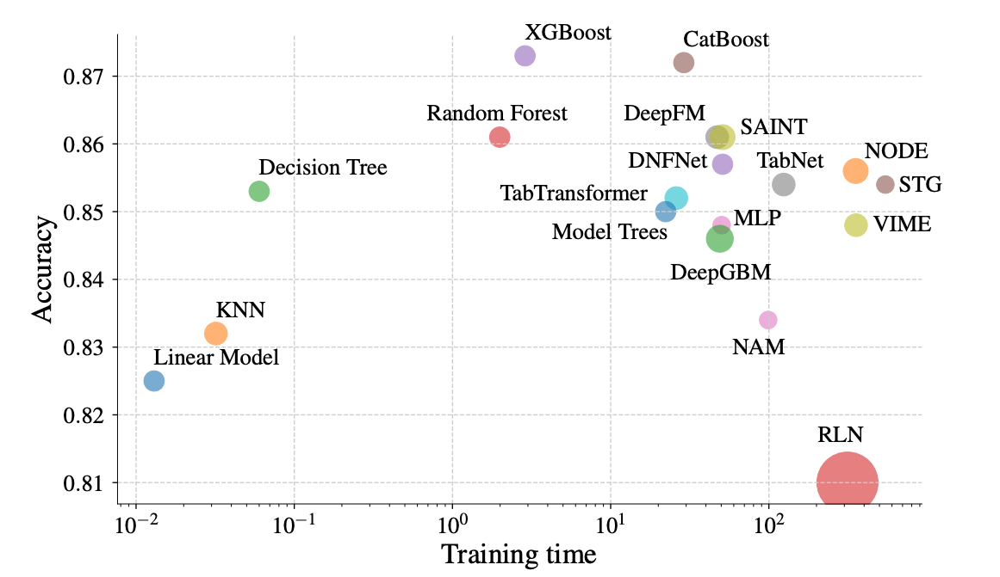
* most recently TabPFN, TabICL (inspired by LLMs)

---

## ML Pipeline

Performance determined by:
- data cleaning
* feature engineering
* the algo
* hyperparameter tuning (for GBMs: lots of)
* ensembles

<!-- -->

* Traditionally:
    - feature engineering: manual, based on domain knowledge
    * hyperparameter tuning: manual or random search etc.

---

# The Age of AI/LLM

## Best Algo for Tabular Data According to AI/LLMs

"what are the best algorithms for supervised learning with tabular data? very short answer"

* Opus 5.5 (Nov. 2026):
    1. **Gradient-boosted trees: LightGBM, XGBoost or CatBoost. These are the default and are hard to beat on most datasets.**
*
    2. Tabular foundation models: TabPFN (v2 or 2.5) and TabICL. On small-to-medium datasets (up to about 10k–50k rows).
    3. Modern deep learning models: TabM and RealMLP.
*
    4. Ensembles and AutoML
*
    5. Baselines: logistic or linear regression and random forests.

---

## LLMs

* "why use the above algos? can't LLMs just look at the data and make better predictions?"

* Mostly no. LLMs that read a table as text and predict directly lose to GBDTs and TabPFN:

   * Numbers become tokens. LLMs are weak at precise numeric comparison and at spotting patterns across thousands of rows.
   * Context limits. 
   * Cost and speed. 
   * Outputs can vary between runs, probabilities are poorly calibrated, and you can't easily validate or reproduce them.

---

## LLMs

- excellent for writing code
- great domain knowledge + can easily acquire more

* Can we use them for
    - feature engineering
    - hyperparameter tuning
* Hence our project for optimizing the ML pipeline using LLMs

---

## Setup

* AI agent (harness + LLM, e.g. codex + GPT-6.1 Sol)
* instructions inspired from Karpathy's autoresearch project
* gets starter ML pipeline for binary classification on a public airline flight delay dataset (Python code: data -> transform -> train XGBoost -> evaluate)
* has 1 hour to iterate/improve it
* can change feature engineering, XGBoost hyperparameters
* reruns pipeline and keeps it if better / discards otherwise
* can do research on the web about what to try next
* each iteration takes 1-2 mins
* one run has typically 30-60 iterations

---

## 1 Run: 1 AI Agent for 1 Hour

* data: train, eval, holdout
* AI agent sees only train + eval, uses eval AUC to iterate
* 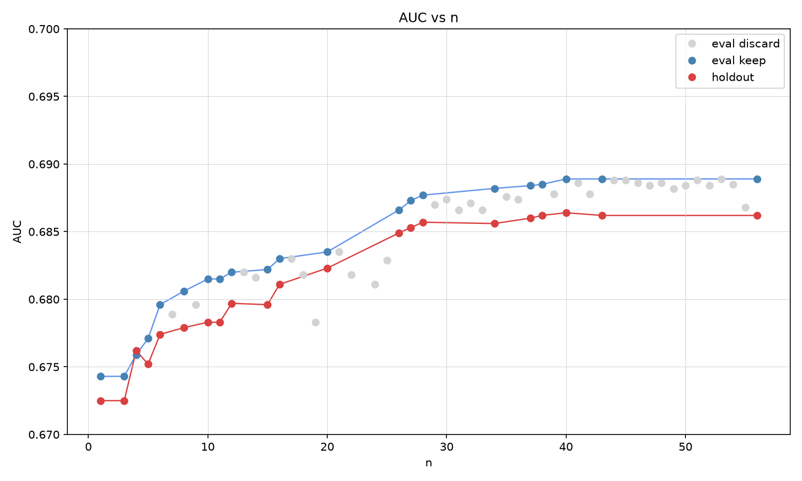

---

## What Makes Improvements

* Feature engineering:
  * Calendar fields as numbers, not categories
  * Add DayOfYear and season features
  * Add holiday offsets (Thanksgiving, Christmas, July 4)
* Hyperparameter Tuning
  * Shallower trees (depth 3–5)
  * More trees at a lower learning rate
  * Regularize the leaves (min_child_weight, lambda, alpha)
  * Subsample rows and columns (0.6–0.8)
* Ensemble (several models + average them)

---

## Million Dollar Question

* How to get good results?
* What determines good performance?
   * strong LLM?
   * the harness?
   * a good setup/prompt?
   * how about performance vs cost?

---

<!-- _class: plot -->

Same setup - 2 LLMs (Sol vs Astra)

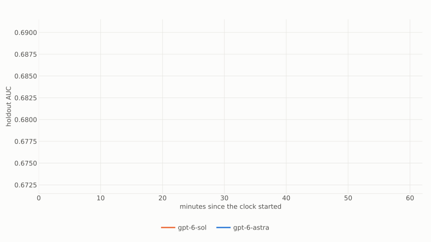

---

<!-- _class: plot -->

Same setup - 2 LLMs (Sol vs Astra)

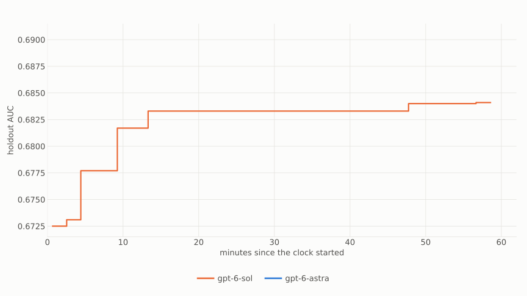

---

<!-- _class: plot -->

Same setup - 2 LLMs (Sol vs Astra)

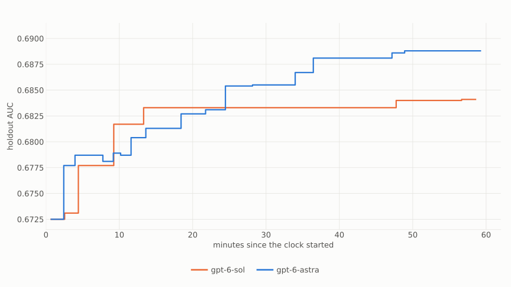

---

<!-- _class: plot -->

Same setup - 2 LLMs (Sol vs Astra)

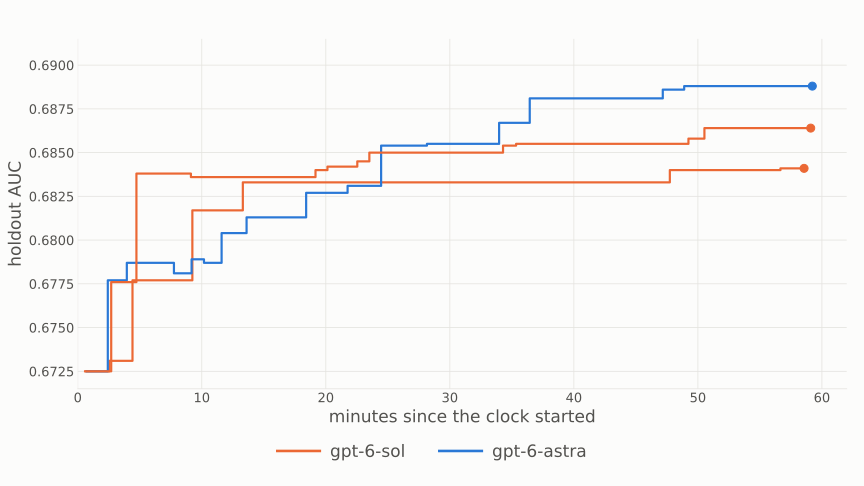

---

<!-- _class: plot -->

Same setup - 2 LLMs (Sol vs Astra)

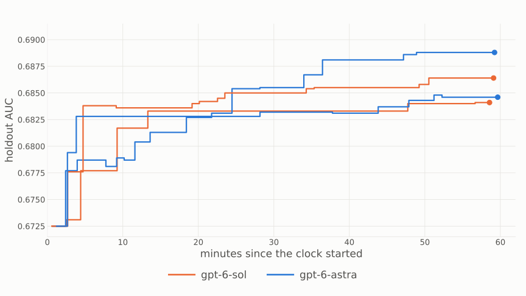

---

<!-- _class: plot -->

Same setup - 2 LLMs (Sol vs Astra)

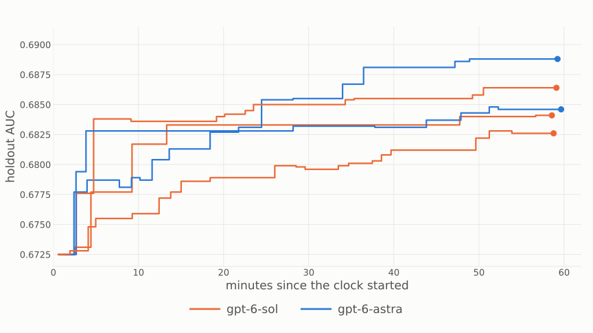

---

<!-- _class: plot -->

Same setup - 2 LLMs (Sol vs Astra)

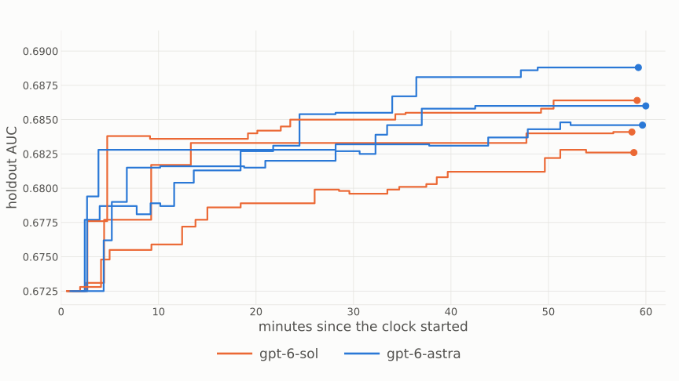

---

<!-- _class: plot -->

Same setup - 2 LLMs - 20 identical runs each

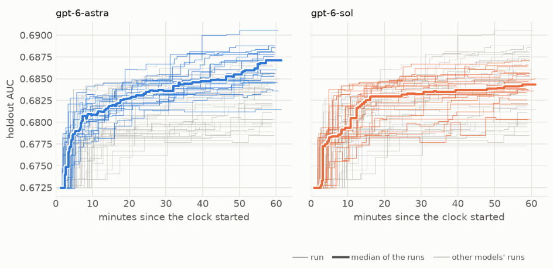

---

<!-- _class: plot -->

Same setup - 3 LLMs - 20 identical runs each

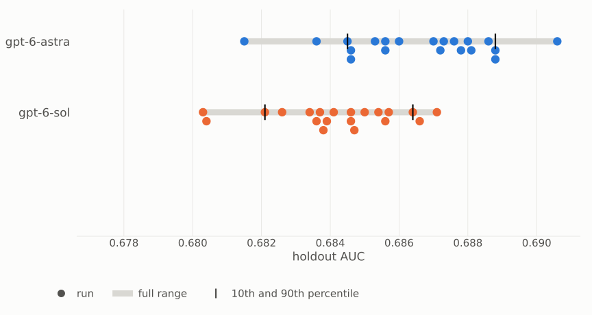

---

<!-- _class: plot -->

Same setup - 3 LLMs - 20 identical runs each

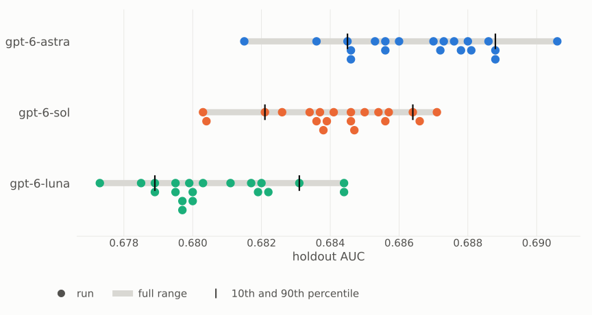

---

<!-- _class: plot -->

Same setup - 3 LLMs - 20 identical runs each

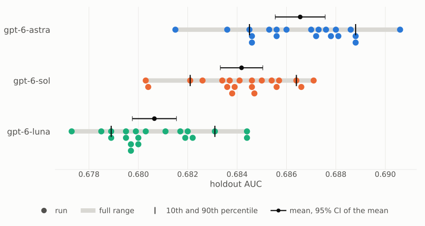

---

