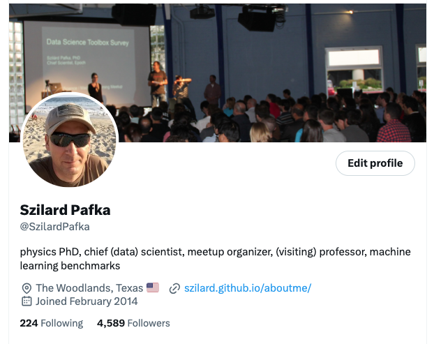

<!-- _class: lead -->

# Benchmarking AI Agents for Optimizing ML Pipelines: An XGBoost Case Study

**Szilard Pafka, PhD**
Chief Scientist, Epoch

Real Data Science Meetup USA · December 2026

---

## Content

